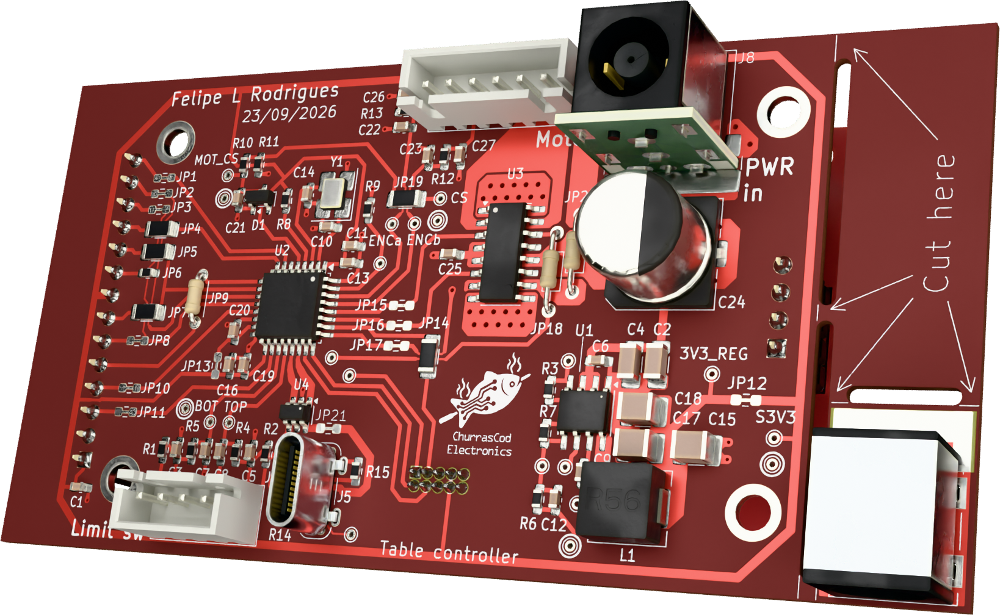
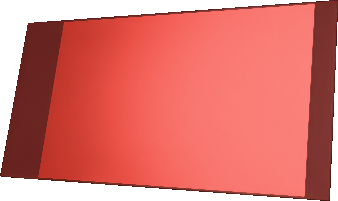

# Desk Controller

**A custom KiCad PCB design for a motorised sit–stand desk controller with a touchscreen human–machine interface (HMI).**

[Hardware design](https://github.com/FLRHW/Desk_controller) · [Firmware repository](https://github.com/FLRHW/Desk_controller_source) · [3D renders](output/3d/) · [Manufacturing outputs](output/)

This repository contains the KiCad hardware design for a desk controller that brings together the user interface, control electronics, motor interface and end-of-travel sensing on one board. It is intended to interface with an external desk mechanism, motor/gearbox/encoder assembly and power supply. The project started as a personal engineering build; the design is published so others can inspect, learn from, or adapt it at their own risk.

Beyond the intended application, the repository documents the design workflow—from system-level architecture and hierarchical schematics through PCB layout, design checks and automated fabrication/assembly deliverables.

> **Project scope:** This repository documents the controller **hardware**. The desk mechanism, motor assembly and external power supply are shown for context and are not part of the PCB design. Do not assume the design is production-ready or safe to connect to a desk without independent electrical, mechanical and functional validation.

## System overview

The design is organised into these functional blocks:

| Block | Purpose |
| --- | --- |
| Microcontroller / control logic | Coordinates the user interface and motor-control signals. |
| Touch display | Local human–machine interface for operating the desk. |
| Servomotor interface | Motor power-drive interface and encoder signal conditioning. |
| Limit-switch interface | Connections and conditioning for end-of-travel signals. |
| 3.3 V DC/DC conversion | Low-voltage supply for the control electronics. |
| Power-supply interface | Connection to the external power source. |

See [`System_overview.kicad_sch`](System_overview.kicad_sch) and [`Block_diagram.kicad_sch`](Block_diagram.kicad_sch) for the system-level drawings. The hierarchical schematic files provide the electrical details.

## PCB renders and design outputs

The renders below are generated from the KiCad PCB design as part of the automated documentation workflow.

| Top view | Bottom view |
| --- | --- |
|  |  |

Additional renders and design files:

- [All 3D renders and models](output/3d/) — angled, top and bottom PNG views, plus the [STEP model](output/3d/Desk_controller-3D.step).
- [Fabrication documentation and files](output/fabrication/) — fabrication drawings, Gerbers and drill outputs (where generated).
- [Assembly documentation and files](output/assembly/) — assembly drawings, BOM/iBOM and placement data (where generated).
- [Design checks and build reports](output/reports/) — ERC/DRC and generation logs.
- [Browse all generated outputs](output/) — full output tree; the [HTML index](output/index.html) is best viewed locally after cloning, as GitHub may show HTML source.
- [Native PCB layout](Desk_controller.kicad_pcb) and [hierarchical schematic](Desk_controller.kicad_sch) — editable KiCad design sources.

The generated files are published to make the design easier to review and reproduce. **Their presence does not imply that the PCB, assembly or motor-control system has been manufactured, tested or validated.** Check the current outputs and reports before considering fabrication.

## Firmware

The firmware is developed separately in **[FLRHW/Desk_controller_source](https://github.com/FLRHW/Desk_controller_source)**. It is **under development and not yet usable**. Please consult that repository for its latest implementation and status; firmware progress is intentionally not duplicated here to avoid maintaining two status reports.

## Repository contents

| Path | Description |
| --- | --- |
| [`Desk_controller.kicad_pro`](Desk_controller.kicad_pro) | KiCad project settings. |
| [`Desk_controller.kicad_sch`](Desk_controller.kicad_sch) | Root hierarchical schematic. |
| [`Desk_controller.kicad_pcb`](Desk_controller.kicad_pcb) | PCB layout. |
| `Microcontroller.kicad_sch` | Control electronics. |
| `Display.kicad_sch` | Display interface. |
| `Servomotor_interface.kicad_sch` | Motor driver and encoder interface circuitry. |
| `Limit_switch_interface.kicad_sch` | Limit-switch interface circuitry. |
| `DCDC_converter_3V3.kicad_sch` | 3.3 V supply stage. |
| `Interface_*.kicad_sch` | External connection/interface drawings. |
| `output/` | Generated documentation and manufacturing exports. |
| `config.kibot.yaml` | KiBot output and documentation configuration. |
| `.github/workflows/`, `ci/`, `scripts/`, `templates/` | Automated generation, helper scripts and drawing worksheets inherited from the KiCad starter. |

## Opening the design

1. Install [KiCad 10](https://www.kicad.org/).
2. Clone the repository:

   ```bash
   git clone https://github.com/FLRHW/Desk_controller.git
   cd Desk_controller
   ```

3. Open `Desk_controller.kicad_pro` in KiCad.
4. Open the schematic editor to navigate the hierarchical sheets, or the PCB editor to inspect the board layout.
5. Run KiCad's Electrical Rules Checker (ERC) and Design Rules Checker (DRC) after making changes, and review the reports before fabricating a board.

This is an **existing project**, not a fresh copy of the starter template: you do not need to run the template's project-creation instructions to open it.

## Generated documentation and manufacturing files

The repository uses [KiBot](https://github.com/INTI-CMNB/KiBot) and GitHub Actions to generate design documentation and manufacturing outputs. Depending on the active `config.kibot.yaml` settings and the latest completed workflow, `output/` can include:

- Schematic, assembly and fabrication PDFs
- ERC/DRC reports
- Bill of materials (BOM) and interactive HTML BOM
- Gerber files and Excellon drill files
- Pick-and-place files and 3D STEP exports
- Optional renders and manufacturing ZIP packages

Open `output/index.html` to browse generated files where available. The original template's documentation contains more details on the export system: [FLRHW KiCad Starter](https://github.com/FLRHW/KiCad_starter).

**Before ordering PCBs:** inspect the actual Gerbers, drill data, stack-up, BOM and fabrication notes. Generated outputs and a passing automation run are not substitutes for electrical and safety verification; inspect ERC/DRC reports separately.

## Development status

This repository contains an evolving hardware design. The presence of schematics, PCB files or manufacturing exports does **not** imply that a physical prototype has been built, tested or validated. Anyone building or operating hardware based on this design must independently assess the risks, verify that the complete system is safe for its intended use, and implement and validate appropriate safeguards before putting it into service. The availability of design files or manufacturing outputs is not evidence of safety or fitness for use. For firmware progress and readiness, refer to the [firmware repository](https://github.com/FLRHW/Desk_controller_source).

## Safety

Motorised desk systems can cause injury or property damage. Before operating hardware based on this design, independently verify power-stage ratings, polarity and protection; limit-switch behaviour; motor direction and feedback; fault handling; and the ability to stop motion reliably. Never rely on software alone as the sole protection against unintended travel.

In the author's personal installation, a manually operated power-disconnect switch is fitted upstream of the power supply feeding the controller. This arrangement is described for reference only and has not been established as a sufficient safety measure for other installations.

Anyone reproducing or adapting this design is responsible for independently assessing the hazards of their complete system, implementing appropriate protective measures, and verifying their effectiveness before use. No particular safety arrangement is prescribed or guaranteed by this project.

## Licensing and reuse

This repository contains material covered by **two separate licences**, according to the origin and purpose of the files:

- **Original hardware design — [CERN-OHL-P-2.0](LICENSE):** The Desk Controller schematics, PCB layout and associated original design and manufacturing files are released under the CERN Open Hardware Licence Version 2 — Permissive. The [`LICENSE`](LICENSE) file contains the hardware licence text.
- **Inherited KiCad starter infrastructure — [MIT](LICENSE-MIT):** Applicable files retained or adapted from [FLRHW/KiCad_starter](https://github.com/FLRHW/KiCad_starter), such as automation scripts, CI workflows and templates, remain under the MIT licence, with their original copyright notices preserved. The [`LICENSE-MIT`](LICENSE-MIT) file contains the corresponding MIT licence and notices.

These licences apply to their respective materials; the presence of both files does **not** mean that the entire repository is offered under a choice of either licence. Third-party dependencies or assets may have their own terms. The [firmware](https://github.com/FLRHW/Desk_controller_source) is maintained separately and is subject to the licensing terms in that repository.

**Disclaimer:** This is a personal engineering project shared **as is**, without warranty of safety, fitness for a particular purpose, completeness or correct operation. Anyone reusing, building, modifying or operating the design is responsible for their own engineering review, applicable regulatory requirements, testing and safeguards. The applicable licence texts govern warranty disclaimers and limitations of liability; this summary does not replace their terms.
